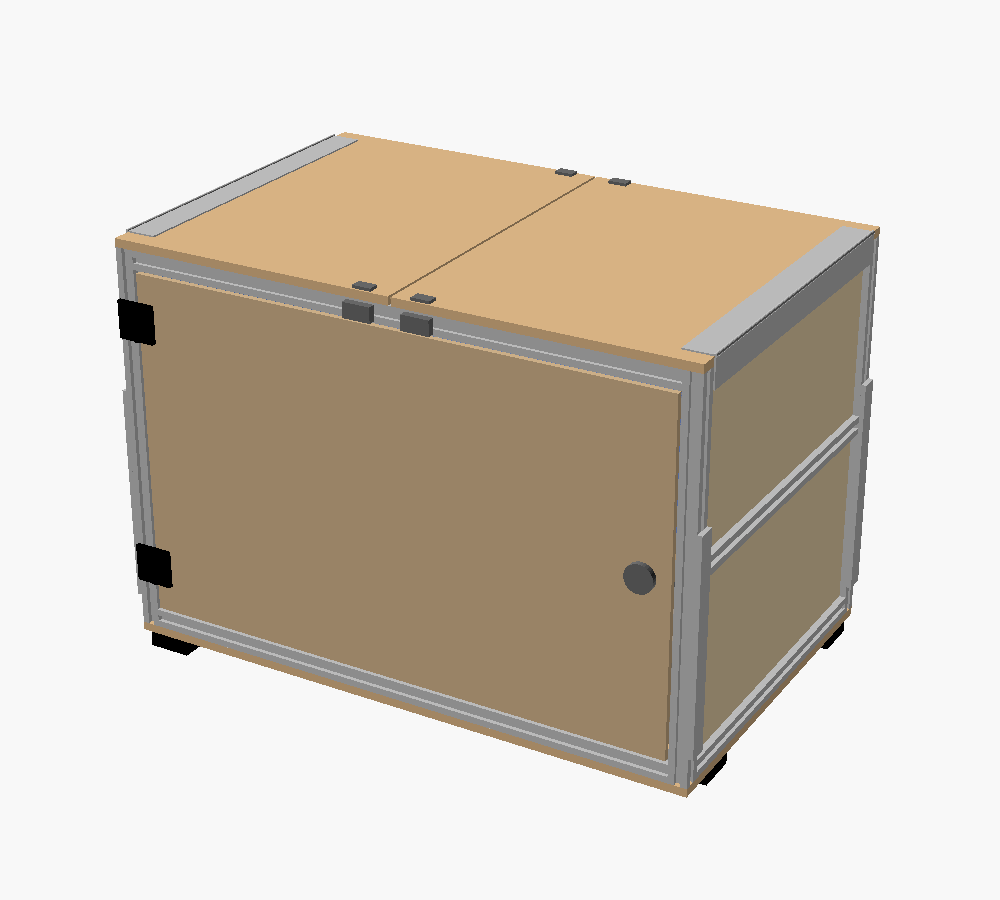
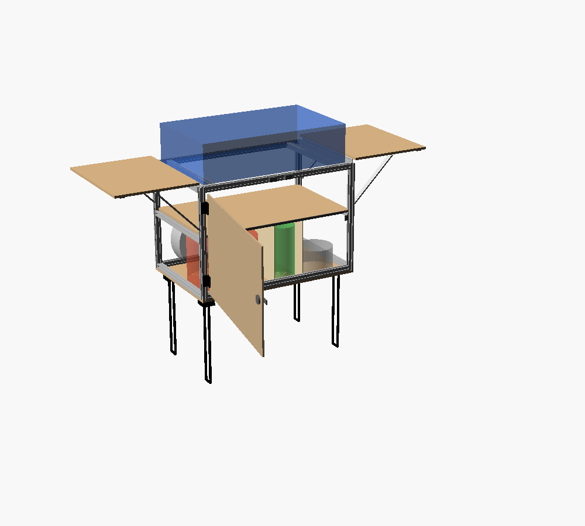
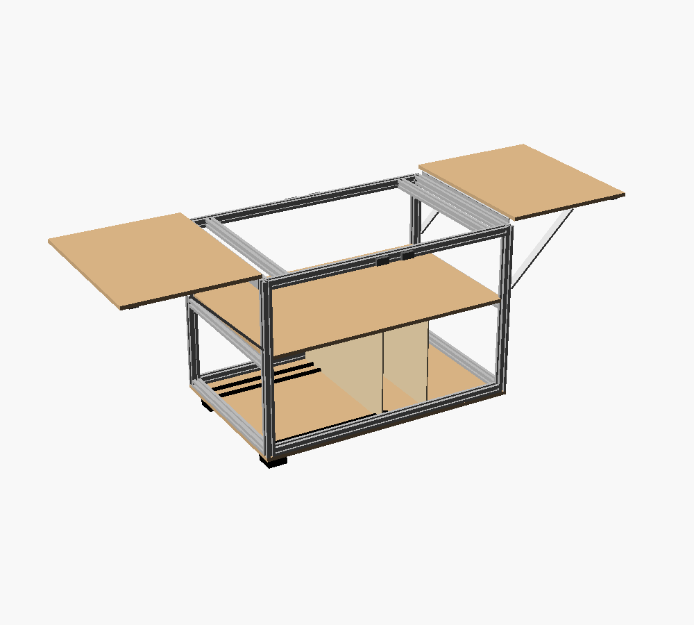

# T-slot Chuck Box: Design Plan

Overall size: **627 W × 400 D × 432 H mm** (24.7 × 15.8 × 17.0 in): a 414.3 mm frame with the 9 mm base under it and the 9 mm lids on top. The inset door closes flush with the frame; the door hinges, latch, lid hinges and lid latches stand a few mm proud, and the folded lid struts add ~5 mm each side (637 mm wide). Open, the two lids flip out as side tables and the box is 1255 mm wide. Standing on its legs, the stove's base is at ~74 cm (29.3") and the side tables at ~76 cm (30.0"); packed with the legs folded, the box is ~452 mm tall. All units are mm.

| Closed | Open, with items | Frame, shelf + dividers |
|---|---|---|
|  |  |  |

## Files
- `chuckbox.scad`: parametric OpenSCAD model. Width, depth and bay heights are calculated from the items, then extrusion lengths are rounded up to the supplier's 1/16" cut grid. Press F5 to preview. The console prints the cut list and weight estimate, and the model stops with an error if an item no longer fits.
- `items.md`: the items the box has to hold, with their dimensions.
- [`parts.md`](parts.md): cut list, hardware and materials, with estimated costs.

## Frame
- 2020 (20 × 20 mm) T-slot aluminum extrusion, TNUTZ EXM-2020, all 4 slots open. Chosen to keep weight down.
- Joints are end-tapped M6 (the ⌀5.48 mm center bore is too big for M5) and bolted, so they need no slot. See [`parts.md`](parts.md#aluminum-extrusion).
- Two front-to-back crossbars in the top frame, 30 mm in from the side rails, carry the stove when cooking. Set their spacing to the stove's feet.
- With the lids hinged instead of bolted, nothing stiffens the top of the frame against racking except the crossbars and the back panel. The base bolted under the frame braces the bottom. Check the assembled frame for wobble; if it racks, add angle brackets at the top back corners.

## Shelving (load-bearing)
- .354" (9 mm) Baltic birch for the base and the one shelf, laser-cut to size.
- The plywood spans between rails on its own. The shelf carries only the stove: at 2× its weight it sags about 0.9 mm, and its 2020 side rails well under 0.1 mm. The dividers aren't counted on to hold anything up.
- The shelf runs full depth, stopping 3 mm behind the closed door (its front edge is the door stop), notched around the corner posts. It rests on the shelf side rails and is held by angle brackets in the rails' inner slots, through-bolted with M5 countersunk bolts and nylon-insert nuts.
- The base covers the whole footprint under the frame, bolted up into the bottom rails. The bottom-bay gear sits on it inside the bottom rails, so it lifts ~20 mm over the bottom front rail to come out. The dish set is a soft stack in a pouch and tilts out.
- Each bay's clear height runs right up to the plywood above.

## Top lids and side tables
- The top is two halves of 9 mm Baltic birch, 312 × 400 mm each, meeting in a 3 mm seam down the middle. Each is hinged along its outer edge with a piano hinge, like a bunker door. Two draw latches per lid hold them closed for transport.
- To cook, flip both lids 180° outward. Each becomes a side table, its closed underside now facing up, 19.5 mm above the stove's base. Then take the stove out of the top bay and stand it on the crossbars between the tables. With the stove and a couple of full pots (~10 kg) on the crossbars, each sags about 0.1 mm.
- Each open lid is propped by two fold-up aluminum struts that pivot on the front and back posts' outer faces and swing up 45° under it. The struts only press on the lid through a rubber pad, landing in a small rubber stop. They don't lock, so a bump from below or lifting the lid drops them. Folded, they clip flat against the posts.
- The tables are for plates, a cutting board or a pot, not for leaning on. With the box empty, about 10 kg at a table's outer edge would tip it sideways.
- Seal both faces of each lid: the top face weathers when closed and the underside is the table surface when open.

## Walls (lightweight)
- .125" (3.2 mm) Baltic birch for the side and back panels, with a rubber gasket in the slot so they don't rattle.
- Panels sit inset directly in the 6.00 ± 0.30 mm T-slots, which saves weight and means no extra brackets.
- Each side wall is split into one panel per bay by the shelf rails. The back is one piece.

## Dividers
- .125" (3.2 mm) Baltic birch, running front to back in the bottom bay. Not load-bearing.
- Each one is fixed with small L-brackets to the base below and the shelf above.

## Door
- **Inset:** 6 mm Baltic birch, sized to the front opening between the posts and between the bottom and top front rails, with a 3 mm gap all round, flush with the frame face when closed. Check the frame's diagonals match within ~1 mm when assembling, and seal the door equally on both faces so it stays flat. Set `door_style = "overlay"` for a door that covers the whole front instead.
- Swing style, hinged on the left with 2 TNUTZ HI-020 hinges. Both leaves lie flat on the front faces, one on the front-left post and one on the door, with the pin in the gap. The hinge T-nuts slide in the slot for up/down adjustment, and the door's hinge holes are slotted 1.5 mm for side-to-side. Leaf thickness (0.196") and hinge length (40 mm) are assumed; measure before cutting.
- A rubber strip on the shelf's front edge stops the door flush.
- Keyed quarter-turn compression latch near the right edge. Its cam hooks a strike tab in the front-right post's inner slot and pulls the door tight against the stop, so it doesn't rattle.

## Legs
- 4 folding hairpin legs, 12.6" (320 mm), solid steel rod, rated 41 lb per leg. They put the stove's base at ~74 cm (29.3") and the side tables at ~76 cm (30.0"); with the stove open, the burners sit at ~84 cm.
- Each leg's plate bolts straight to the base plywood under a corner, into rail T-nuts where the holes land under a rail.
- All four fold left-right under the box. In each front-and-back pair, the right-hand leg is mounted one leg width further in, so the folded legs pass side by side. Folded, they add ~20 mm to the packed height.
- **Check the hinge locks open** before relying on it; the listing doesn't say.
- **Tipping:** the box is only 400 mm deep, so standing it tips front-to-back easily. Roughly a 5 kg sideways push at the stove's base height tips it loaded, ~2.9 kg empty (estimate). The heavy gear is in the bottom bay, which helps a little. Don't lean on the front edge.

## Bay layout (bottom → top)

| Bay | Clear height | Contents | Dividers |
|---|---|---|---|
| Bottom | 227.9 mm | Stanley cook set (170 mm) with the dish set standing on edge behind it (216 mm), 2 × 1 lb propane cylinders (203 mm), MSR Pika teapot (89 mm) | 2, sized to contents: 280 (cook set + dish set) / 115 (propane) / 186 (teapot) |
| Top | 177.4 mm (157.4 under the crossbars) | Coleman Triton+ stove (145 mm) | None |

The gear (7.4 kg) goes in the bottom bay, under the shelf, so it's low and nothing is stored right under the burners: the stove's own bay is empty while it's out on top. Both propane cylinders stand upright in the middle compartment, one behind the other. The dish set stands on edge behind the cook set, so the pots come out first. About 186 × 208 × 228 mm is free behind the teapot.

## Weight

**Dry: ~13.4 kg (29.4 lb). Gross: ~24.6 kg (54.2 lb).** These are estimates from the model's cut list using typical material weights.

| Component | Basis | Est. weight |
|---|---|---|
| T-slot extrusion | 6.9 m of EXM-2020 at 0.454 kg/m | 3.1 kg |
| 9 mm Baltic birch (base, shelf, 2 lids) | 0.73 m² at ~680 kg/m³ | 4.5 kg |
| 3.2 mm Baltic birch (walls, dividers) | 0.67 m² at ~680 kg/m³ | 1.4 kg |
| 6 mm Baltic birch (door) | 0.21 m² at ~680 kg/m³ | 0.9 kg |
| Lid struts (4) | 230 × 20 × 5 mm aluminum flat bar | 0.2 kg |
| Legs (4) | Steel hairpin legs (~0.5 kg each, est.) | 2.0 kg |
| Hardware | Bolts, T-nuts, brackets, door and lid hinges, latches, panel gasket | 1.2 kg |
| **Dry weight** | Empty box | **13.4 kg** |
| Items | Stove 3.86, cook set 3.72, propane 2 × ~0.91, teapot 0.15, dish set 1.70 kg | 11.2 kg |
| **Gross weight** | Box + items | **24.6 kg** |

## Fit settings

| Setting | Value | Meaning |
|---|---|---|
| `clearance` | 6 mm | Space per side around each stored item |
| `slot_engage` | 5 mm | How far wall panels sit into the T-slot past the extrusion face |
| `xbar_in` | 30 mm | Gap between each top crossbar and its side rail; set so the crossbars land under the stove's feet |
